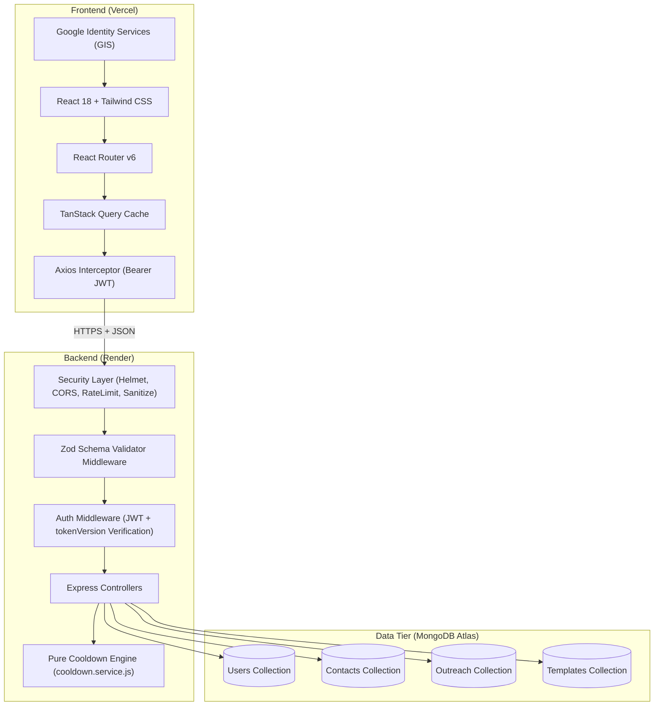
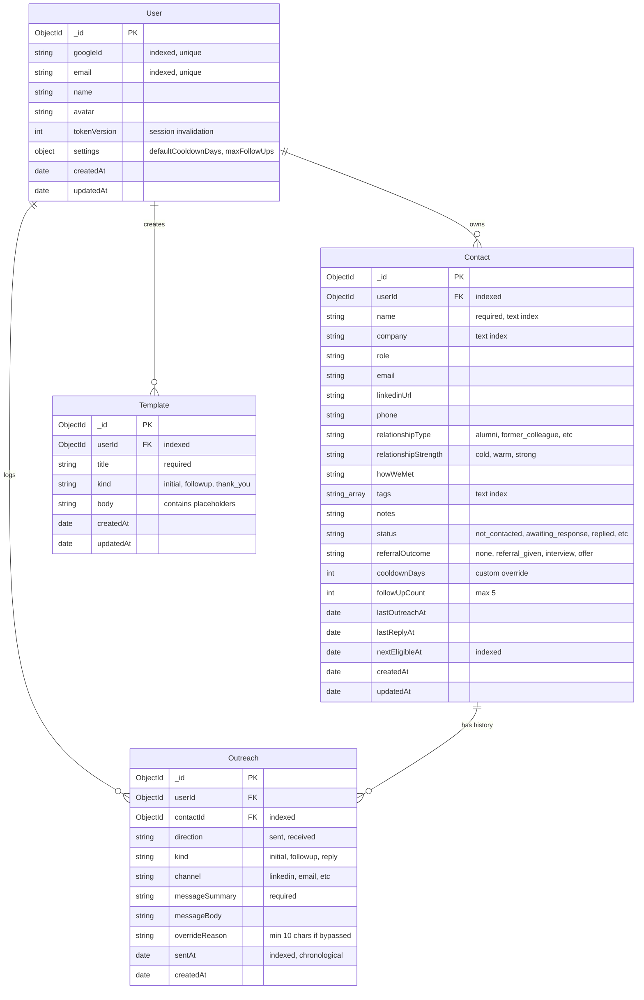

# ReferralCircle 🚀
> **Professional Referral Outreach Organizer with Automated Etiquette & Cooldown Safeguards**

ReferralCircle is a full-stack web application designed for students and graduates navigating job search networking. It helps job-seekers track cold outreach, alumni referrals, and conversations respectfully by enforcing **server-side cooldown intervals** and a strict **5-attempt follow-up ceiling**.

---

## 🌟 Key Features

- **Google OAuth 2.0 Only**: One-click authentication using Google Identity Services with server-verified ID tokens.
- **Strict User-Data Isolation**: Every database operation is strictly scoped by `userId`. Unauthorized access attempts return `404 Not Found` (never `403`) to eliminate resource enumeration.
- **Server-Enforced Cooldown Engine**:
  - Automatically calculates `nextEligibleAt` based on user defaults or custom per-contact overrides.
  - Rejects premature follow-ups with `409 COOLDOWN_ACTIVE` unless explicitly overridden with a valid justification (min 10 characters).
  - Caps maximum follow-ups at 5 (`422 MAX_FOLLOWUPS_REACHED`) to prevent spamming recruiters or alumni.
  - Logging a received reply resets both the follow-up counter and the cooldown timer immediately.
- **Dynamic Outreach Timeline & Event Sourcing**: Adding or deleting communication records automatically recalculates contact metrics and future eligible dates.
- **Message Templates with Dynamic Substitution**: Create customizable message drafts with automatic token replacement (`{{contactName}}`, `{{company}}`, `{{role}}`, `{{myName}}`).
- **Interactive Visual Analytics (Recharts)**:
  - Real-time conversion funnel (Total Contacts ➔ Contacted ➔ Replied ➔ Referrals ➔ Interviews ➔ Offers).
  - Channel-by-channel response rate comparisons (LinkedIn vs Email vs WhatsApp).
  - Weekly outreach volume trends.
- **Session Security & Portability**:
  - Global session invalidation (`tokenVersion` increment) via "Logout Everywhere".
  - RFC 4180-compliant CSV export for offline backups.
  - Permanent account self-deletion with cascading data cleanup.
- **Responsive & Accessible Dark Mode**: Mobile-first interface designed for screens from 360px up to 4K displays, with dark mode preference detection and WCAG-compliant contrast.

---

## 🛠️ Tech Stack

| Area | Technology | Purpose |
|---|---|---|
| **Frontend** | React 18, Vite | Single-page application engine and fast bundler |
| **Styling** | Tailwind CSS | Utility-first styling with responsive and dark mode classes |
| **Routing** | React Router v6 | Client-side routing and authenticated route protection |
| **State / Data** | TanStack Query v5, Axios | Server-state caching, optimistic mutations, and token interceptor |
| **Icons & Charts** | Lucide React, Recharts | Minimalist icons and SVG data analytics charts |
| **Notifications** | React Hot Toast | Accessible toast notifications for actions and errors |
| **Backend** | Node 22, Express | RESTful API server |
| **Database** | MongoDB Atlas, Mongoose | Cloud document database with compound and text indexing |
| **Validation** | Zod | Strict schema validation for request bodies, params, and queries |
| **Security** | Helmet, CORS, Rate Limit, Mongo Sanitize | HTTP headers, origin whitelist, anti-brute force, query sanitization |
| **Testing** | Vitest, Supertest | Fast unit and integration test runner |

---

## 🏗️ System Architecture



---

## 🗄️ Database Entity-Relationship (ER) Schema



---

## ⏱️ The Cooldown Rule Explained

```
effectiveCooldownDays = contact.cooldownDays ?? user.settings.defaultCooldownDays (default: 7)
```

1. **First Ever Outreach (`kind=initial`)**:
   - Permitted immediately without cooldown checks.
   - Sets `status = 'awaiting_response'`, `followUpCount = 0`, `lastOutreachAt = now`.
   - Schedules `nextEligibleAt = now + effectiveCooldownDays`.
2. **Follow-up Outreaches (`kind=followup`)**:
   - **Hard Cap Rule**: If `followUpCount >= 5`, rejected with HTTP `422 MAX_FOLLOWUPS_REACHED`. No override possible.
   - **Active Cooldown Rule**: If `now < nextEligibleAt`, rejected with HTTP `409 COOLDOWN_ACTIVE` (including `daysLeft`).
   - **Override Bypass**: Allowed only if payload includes `override: true` and an `overrideReason` of at least 10 characters explaining why the follow-up cannot wait.
   - On success: `followUpCount += 1`, `lastOutreachAt = now`, `nextEligibleAt = now + effectiveCooldownDays`.
3. **Received Reply (`direction=received`, `kind=reply`)**:
   - Sets `status = 'replied'`, `lastReplyAt = now`.
   - **Resets** `followUpCount = 0` and sets `nextEligibleAt = null`.
4. **Outreach Deletion Replay**:
   - When an outreach event is deleted, the server chronologically replays the remaining communication history to restore exact past status, counts, and dates.

---

## 💻 Local Setup (Windows 11 PowerShell)

### Prerequisites
- **Node.js**: v22.0.0 or higher
- **MongoDB Atlas**: Free M0 cluster account or local MongoDB instance

### Step 1: Clone and Enter Repository
```powershell
git clone <your-repo-url>
cd "REFERRAL PROJECT, BACKEND CIA2"
```

### Step 2: Configure Server Environment
```powershell
Copy-Item server\.env.example server\.env
```
Fill in `server/.env`:
```env
PORT=5000
CLIENT_URL=http://localhost:5173
MONGODB_URI=mongodb+srv://<username>:<password>@cluster0.mongodb.net/referralcircle?retryWrites=true&w=majority
JWT_SECRET=your_secure_random_64_char_secret_key_here
GOOGLE_CLIENT_ID=your_google_client_id.apps.googleusercontent.com
```

### Step 3: Configure Client Environment
```powershell
Copy-Item client\.env.example client\.env
```
Fill in `client/.env`:
```env
VITE_API_URL=http://localhost:5000/api
VITE_GOOGLE_CLIENT_ID=your_google_client_id.apps.googleusercontent.com
```

### Step 4: Install Dependencies & Run Tests
```powershell
npm --prefix server install
npm --prefix client install
npm --prefix server test
```

### Step 5: Seed Demo Database (Optional)
```powershell
npm --prefix server run seed
```

### Step 6: Start Development Servers
Open two terminal windows:
```powershell
# Terminal 1: Backend
npm --prefix server run dev

# Terminal 2: Frontend
npm --prefix client run dev
```
Open **`http://localhost:5173`** in your browser.

---

## 🔑 Environment Variables Reference

### Backend (`server/.env`)
| Variable | Required | Default | Description |
|---|---|---|---|
| `PORT` | No | `5000` | Port for Express API server |
| `CLIENT_URL` | Yes | `http://localhost:5173` | Allowed origin for CORS whitelist (comma-separated for multi-origin) |
| `MONGODB_URI` | Yes | — | MongoDB Atlas connection string |
| `JWT_SECRET` | Yes | — | Cryptographic secret for signing session JWT tokens |
| `GOOGLE_CLIENT_ID` | Yes | — | Google OAuth 2.0 Web Client ID for ID token signature validation |

### Frontend (`client/.env`)
| Variable | Required | Default | Description |
|---|---|---|---|
| `VITE_API_URL` | Yes | `http://localhost:5000/api` | Base URL for REST API endpoints |
| `VITE_GOOGLE_CLIENT_ID` | Yes | — | Client ID for Google Identity Services frontend button |

---

## 📡 REST API Endpoint Reference

All endpoints return JSON responses with standard envelope `{ data, meta? }` or `{ error: { code, message, details? } }`.

| Method | Endpoint | Auth | Description |
|---|---|---|---|
| `GET` | `/health` | No | Deployment health check (`{ status: "ok" }`) |
| `POST` | `/api/auth/google` | No | Exchange Google ID token for custom 7-day session JWT |
| `GET` | `/api/auth/me` | Bearer | Get authenticated user profile and settings |
| `POST` | `/api/auth/logout-all` | Bearer | Invalidate all sessions by incrementing `tokenVersion` |
| `GET` | `/api/settings` | Bearer | Get user cooldown and follow-up settings |
| `PATCH` | `/api/settings` | Bearer | Update cooldown settings (triggers contact recalculation) |
| `DELETE` | `/api/settings` | Bearer | Delete account and cascade delete all user data |
| `GET` | `/api/contacts` | Bearer | List contacts with search (`q`), filters, sort, pagination |
| `POST` | `/api/contacts` | Bearer | Create a new contact scoped to user |
| `GET` | `/api/contacts/:id` | Bearer | Get contact details (returns 404 for other users' records) |
| `PATCH` | `/api/contacts/:id` | Bearer | Update contact details and optional custom cooldown |
| `DELETE` | `/api/contacts/:id` | Bearer | Delete contact and cascade delete all its outreach |
| `GET` | `/api/contacts/:id/outreach` | Bearer | Get chronological communication timeline for contact |
| `POST` | `/api/contacts/:id/outreach` | Bearer | Log sent outreach or received reply (enforces cooldown) |
| `DELETE` | `/api/outreach/:id` | Bearer | Delete outreach event and recompute contact dates |
| `GET` | `/api/templates` | Bearer | List user's message templates |
| `POST` | `/api/templates` | Bearer | Create a new template |
| `GET` | `/api/templates/:id/render` | Bearer | Render template with contact's placeholders filled |
| `PATCH` | `/api/templates/:id` | Bearer | Update an existing template |
| `DELETE` | `/api/templates/:id` | Bearer | Delete a template |
| `GET` | `/api/dashboard` | Bearer | Summary stat counts, follow-up alerts, upcoming dates |
| `GET` | `/api/analytics` | Bearer | Channel response rates, status funnel, weekly volume |
| `GET` | `/api/export/contacts.csv` | Bearer | Export all user contacts to downloadable CSV |

---

## 🧪 Automated Testing

Automated test suites are built with **Vitest** and **Supertest** covering cooldown boundary logic, UTC time arithmetic, Zod validation, cross-user data isolation, and API routes.

```powershell
npm --prefix server test
```

### Test Coverage Highlights
- Cooldown active rejection (409) and remaining days calculation.
- Boundary condition (`now === nextEligibleAt`) allowance.
- Per-contact override prioritization over user default cooldown.
- Override bypass with 10+ character justification.
- Rejection of invalid overrides (< 10 chars).
- Automatic count and cooldown reset upon receiving a reply.
- Hard block at 5 follow-ups (422) with override disabled.
- Chronological timeline replay on event deletion.
- Cross-user data isolation returning 404 (preventing resource enumeration).

---

## 🚀 Step-by-Step Production Deployment

### 1. Push Code to GitHub
```powershell
git remote add origin https://github.com/<your-username>/referralcircle.git
git branch -M main
git push -u origin main
```

### 2. Backend Deployment on Render
1. Log in to [Render Dashboard](https://dashboard.render.com/) and click **New ➔ Web Service**.
2. Connect your GitHub repository.
3. Configure the service settings:
   - **Name**: `referralcircle-server`
   - **Root Directory**: `server`
   - **Runtime**: `Node`
   - **Build Command**: `npm install`
   - **Start Command**: `npm start`
   - **Instance Type**: `Free`
4. In **Environment Variables**, add:
   - `PORT`: `5000`
   - `NODE_ENV`: `production`
   - `MONGODB_URI`: `<Your MongoDB Atlas Connection String>`
   - `JWT_SECRET`: `<Generated 64-char random hex key>`
   - `GOOGLE_CLIENT_ID`: `<Your Google Web Client ID>`
   - `CLIENT_URL`: `https://your-referralcircle.vercel.app` *(update after step 3)*
5. Click **Create Web Service**. Note your Render URL: `https://referralcircle-server.onrender.com`.

### 3. Frontend Deployment on Vercel
1. Log in to [Vercel](https://vercel.com/) and click **Add New ➔ Project**.
2. Import your GitHub repository.
3. Configure the project:
   - **Framework Preset**: `Vite`
   - **Root Directory**: Click edit and select `client`.
4. In **Environment Variables**, add:
   - `VITE_API_URL`: `https://referralcircle-server.onrender.com/api`
   - `VITE_GOOGLE_CLIENT_ID`: `<Your Google Web Client ID>`
5. Click **Deploy**. Note your Vercel URL: `https://your-referralcircle.vercel.app`.

### 4. Link Production URLs in Cloud Consoles
1. **Render**: Return to Render, open your Web Service's environment variables, and update `CLIENT_URL` to your Vercel URL (`https://your-referralcircle.vercel.app`).
2. **MongoDB Atlas**: In *Network Access*, add `0.0.0.0/0` (allow access from anywhere, required for Render dynamic IP egress).
3. **Google Cloud Console**:
   - Go to *APIs & Services ➔ Credentials ➔ OAuth 2.0 Client IDs*.
   - Under **Authorized JavaScript origins**, add:
     - `https://your-referralcircle.vercel.app`
   - Under **Authorized redirect URIs**, add:
     - `https://your-referralcircle.vercel.app`

---

## 📸 Application Screenshots

*(Placeholder section for viva presentations and project documentation)*

| Screen | Preview Placeholder |
|---|---|
| **Pipeline Dashboard** | `` |
| **Contacts Table & Timing Chips** | `` |
| **Cooldown Rule Warning & Override Modal** | `` |
| **Message Templates & Dynamic Tokens** | `` |
| **Dark Mode Interface** | `` |

---

## 🔒 Post-Deployment Smoke-Test Checklist

- [ ] **Health Endpoint**: Visit `https://referralcircle-server.onrender.com/health` and verify `{ "data": { "status": "ok" } }` returns with HTTP 200.
- [ ] **CORS Verification**: Open the Vercel frontend in browser developer tools (Network tab) and ensure requests succeed without CORS pre-flight errors.
- [ ] **Google Sign-In**: Click the Google Sign-in button on Vercel; verify the popup succeeds and stores the JWT in `localStorage`.
- [ ] **Cooldown Enforcement**: Add a contact, log a sent outreach, and attempt an immediate second sent outreach without override; confirm the UI shows **"Available in N days"** and API blocks with `409 COOLDOWN_ACTIVE`.
- [ ] **CSV Export & Logout Everywhere**: Trigger CSV download from Settings, then click "Logout Everywhere" and verify your session is immediately invalidated.
